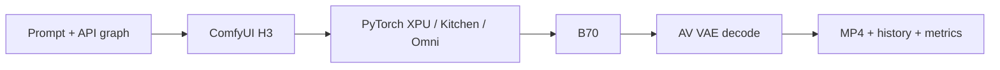

# MiniMax-H3 on Intel B70 — Minimal Deployment & Test

[English](README.md) | [简体中文](README.zh-CN.md)

A standalone blog companion for single-B70 inference: submit, monitor and verify text-to-audiovisual MP4 generation using quantized H3 Base in Omni/ComfyUI. Includes lightweight clients and configuration only; no llm-scaler source, images, weights, internal logs or personal information.

## Scope and requirements

Recorded baseline: `intel/llm-scaler-omni:0.2.0-b1`, Python 3.12.3, PyTorch 2.11.0+xpu, ComfyUI 0.31.0, Torch SDPA, DynamicVRAM and a 4 GiB reserve. Inference uses PyTorch XPU. The complete official H3 system also includes Context-IR and Regenerate-2K; neither cloud module is used here.

- Single B70/Battlemage with approximately 32 GB VRAM; 64 GB host RAM recommended.
- Linux with platform-compatible Xe/GuC and GPU user runtime; accessible `/dev/dri`.
- Docker access, Python 3 (standard-library-only clients), FFmpeg/FFprobe; optional xpu-smi and OpenSSH.
- About 42.5 GB for weights; at least 100 GB free disk recommended. Duplicate caches and source builds need more.
- Recorded successes are 768×448 at 5.167/10.125 seconds; completed 768p/15-second or 2K generation is not claimed.



## 1. Get this project and upstream

Replace the placeholder with your published GitHub repository URL, or extract the package ZIP. Clone llm-scaler alongside this repository; do not vendor it or add it as a submodule.

```bash
git clone https://github.com/<owner>/<repo>.git minimax-h3-b70-minimal
cd minimax-h3-b70-minimal
git clone https://github.com/intel/llm-scaler.git ../llm-scaler
python3 --version
docker --version
ffprobe -version
```

Upstream documentation is in `../llm-scaler/omni/README.md`. Running these steps does not require an upstream source build; prefer the published image. Upstream main may be newer than this b1 baseline.

## 2. Prepare the image and GPU

```bash
docker pull intel/llm-scaler-omni:0.2.0-b1
docker image inspect intel/llm-scaler-omni:0.2.0-b1 --format '{{json .RepoDigests}}'
lspci -nnk | grep -A3 -Ei 'VGA|Display'
ls -l /dev/dri
bash check_xpu.sh
docker run --rm --device=/dev/dri intel/llm-scaler-omni:0.2.0-b1 \
  python /llm/tools/validate_comfyui_image.py
```

Expected compute check: `available=True`, `count=1`, `matmul=64.0`. Resolve driver/device access issues before loading H3; a render node alone does not prove compute works.

Optional source build (outside the recorded published-image path):

```bash
cd ../llm-scaler/omni
XPU_TARGET=bmg bash build.sh
cd ../../minimax-h3-b70-minimal
# Set H3_IMAGE to the actual tag printed by the build, then repeat checks.
```

If b1 is unavailable, consult upstream releases rather than assuming a new image is compatible. Set `export H3_IMAGE=<actual-tag>` to select an image and repeat validation.

## 3. Prepare the four checkpoints

```bash
export H3_DATA_DIR="$HOME/h3-data"
mkdir -p "$H3_DATA_DIR"/{models/{diffusion_models,text_encoders,vae,loras/h3},input,output,user}
cp extra_model_paths.yaml "$H3_DATA_DIR/extra_model_paths.yaml"
df -h "$H3_DATA_DIR"
```

Get these exact files from [Comfy-Org/MiniMax-H3](https://huggingface.co/Comfy-Org/MiniMax-H3), or reuse existing downloads. Follow the publisher licenses. Original BF16 checkpoints are not drop-in replacements.

| File | Directory under `models/` | Approx. size |
|---|---|---|
| minimax_h3_fl2va_pruned_int8_convrot.safetensors | diffusion_models | 20.97 GB |
| qwen3vl_32b_minimax_h3_nvfp4_awq.safetensors | text_encoders | 15.69 GB |
| minimax_h3_video_vae_fp16.safetensors | vae | 5.21 GB |
| minimax_h3_audio_vae_fp32.safetensors | vae | 0.61 GB |

Optional CLI download:

```bash
python3 -m venv .download-env
.download-env/bin/python -m pip install huggingface_hub
.download-env/bin/hf download Comfy-Org/MiniMax-H3 \
  --include '*minimax_h3_fl2va_pruned_int8_convrot.safetensors' \
            '*qwen3vl_32b_minimax_h3_nvfp4_awq.safetensors' \
            '*minimax_h3_video_vae_fp16.safetensors' \
            '*minimax_h3_audio_vae_fp32.safetensors' \
  --local-dir downloads
```

Downloads may retain upstream subdirectories. Locate and install them below. Copying temporarily uses another 42.5 GB; move instead after checking paths if space is tight. Stop and check versions if old filenames are missing.

```bash
python3 - <<'PY'
import os, shutil
from pathlib import Path
base = Path(os.environ['H3_DATA_DIR']) / 'models'
files = {
 'minimax_h3_fl2va_pruned_int8_convrot.safetensors':'diffusion_models',
 'qwen3vl_32b_minimax_h3_nvfp4_awq.safetensors':'text_encoders',
 'minimax_h3_video_vae_fp16.safetensors':'vae',
 'minimax_h3_audio_vae_fp32.safetensors':'vae',
}
for name, folder in files.items():
    found = list(Path('downloads').rglob(name))
    assert len(found) == 1, (name, len(found))
    shutil.copy2(found[0], base / folder / name)
    print('Installed', folder, name)
PY
find "$H3_DATA_DIR/models" -name '*.safetensors' -exec sha256sum {} \; > model_sha256.txt
```

## 4. Start the service

```bash
export H3_DATA_DIR="$HOME/h3-data"
bash start_h3_b70.sh
docker logs --tail 80 minimax-h3-b70-torch
python3 wait_ready.py --timeout 180
```

The script creates directories and checks checkpoint files. The port binds to host 127.0.0.1:8188 only. The readiness tool checks XPU presence and an empty queue; a container ID is not readiness. Look for `Starting server`.

An existing container is reused with its old mounts/environment. After confirming the queue is idle, use `docker stop minimax-h3-b70-torch`, `docker rm minimax-h3-b70-torch`, then start again to apply changes. Bind-mounted data remains.

## 5. Run a smoke test, then the harbor scene

```bash
python3 verify_minimax.py --url http://127.0.0.1:8188 \
  --width 256 --height 160 --frames 124 --steps 20 --seed 42 \
  --submit --wait --timeout 1200 --output workflows/smoke_api.json

python3 verify_minimax.py --url http://127.0.0.1:8188 \
  --width 768 --height 448 --frames 124 --steps 20 --seed 70 \
  --prompt-file prompts/harbor_5s.txt \
  --submit --wait --timeout 1800 --output workflows/harbor_api.json
```

Wait for each job to finish before starting the next. Omit `--submit --wait` to export the API graph without GPU work. API JSON is not a positioned UI workflow.

Expected client output (illustrative):

```text
Requested 768x448, 124 frames at 24 fps (5.167 seconds), 20 sampling steps, seed 70.
{"prompt_id": "...", "node_errors": {}}
Saved ..._NoLoRA_..._time155.47s_VRAMpeakNA.mp4 (... bytes)
Generation succeeded; saved .../history_<prompt_id>.json
```

155.47 seconds is a recorded baseline, not a guaranteed runtime. NA is expected without VRAM collection and does not mean zero usage. Outputs go to `artifacts/videos/`, `artifacts/history/` and `artifacts/reports/`; server copies remain under `$H3_DATA_DIR/output/video/`.

## 6. Progress and VRAM collection (optional)

Start the listener in another terminal before submitting. Use only one listener with this client ID:

```bash
python3 watch_comfy_progress.py --timeout 1800 \
  --output artifacts/diagnostics/progress.jsonl
```

Start VRAM collection before submission too. Discover the actual device ID rather than assuming a PCI address. Collector terminal:

```bash
xpu-smi discovery
python3 collect_metrics.py --device 0 --timeout 1800 \
  --output artifacts/diagnostics/harbor_vram.jsonl
```

Generation terminal (same host and project as the collector):

```bash
python3 verify_minimax.py --width 768 --height 448 --frames 124 --steps 20 \
  --seed 70 --prompt-file prompts/harbor_5s.txt \
  --metrics-file artifacts/diagnostics/harbor_vram.jsonl \
  --submit --wait --timeout 1800
```

Downloaded filenames include time, sampled device-wide peak VRAM and a LoRA tag. VRAM includes driver/other processes and is neither host RAM nor Torch allocations. Sampling may miss peaks; changed xpu-smi schemas may produce NA. Docker RAM is not VRAM.

## 7. Verify frames, duration and audio

```bash
VIDEO='artifacts/videos/<actual-output>.mp4'
ffprobe -v error -count_frames \
  -show_entries stream=codec_type,codec_name,width,height,r_frame_rate,duration,nb_read_frames,sample_rate,channels \
  -of json "$VIDEO"
ffmpeg -v error -i "$VIDEO" -f null -
```

For the harbor configuration expect 124 video frames, 24 fps, 5.166667 seconds and 32 kHz stereo audio. ffmpeg should exit successfully without decoding errors. Review motion and AV synchronization in a player; audio presence is not subjective quality approval.

## 8. Remote client (optional)

```bash
ssh -N -o ExitOnForwardFailure=yes \
  -L 18188:127.0.0.1:8188 <ssh_user>@<b70_host>
# In another terminal, inside your local copy:
python verify_minimax.py --url http://127.0.0.1:18188 \
  --width 768 --height 448 --frames 124 --steps 20 --seed 70 \
  --prompt-file prompts/harbor_5s.txt --submit --wait
```

Keep the SSH tunnel open. Browse http://127.0.0.1:18188 . A Windows client needs no GPU/PyTorch; use curl.exe in PowerShell. VRAM collection stays on the B70 host; synchronize files before using a local metrics-file. For complete performance capture, submit on B70 and copy the archive afterward.

## 9. Parameters, caveats and stopping

- Width/height must be positive multiples of 32; frames follow 17k+5; fps is fixed at 24. 124/243/362 frames are about 5.167/10.125/15.083 seconds.
- steps means denoising steps, not seconds. Writing “15 seconds” in a prompt does not change frame count.
- `--tiled-vae` reduces decoding pressure, not sampling problems.
- Optional `--lora h3/<adapter>.safetensors`: put weights in models/loras/h3 and verify checkpoint build, sampler/shift and adapter versions. Turbo needs its prescribed settings; arbitrarily reducing baseline steps is not equivalent.
- `--output` is the workflow JSON path; `--artifacts-dir` is the result root. Client relative paths resolve against its script directory.
- High GPU utilization and static logs do not prove a hang; inspect WebSocket sampling progress.
- A timeout does not cancel the server job. Check queue/history before retrying.

```bash
curl --noproxy '*' -fsS http://127.0.0.1:8188/queue
python3 verify_minimax.py --history '<actual-prompt-id>'
# Interrupt only when the running job is yours and can be stopped:
curl --noproxy '*' -fsS -X POST http://127.0.0.1:8188/interrupt
# Stop the service after work is complete:
docker stop minimax-h3-b70-torch
```

For DEVICE_LOST/Xe wedged/GuC errors, save evidence and stop retrying. A container restart is not a GPU reset; coordinate shared-host reboots. No unverified PCI reset/unbind commands are provided. Sanitize logs/history before publishing.

## Results and references

Recorded baseline: 155.47 s / 28.68 GiB; Turbo 8-step: 84.07 s / 28.69 GiB (single-pair 1.85× speedup). A 10.125-second output also completed. 1344×768 advanced at about 118 s/step and was canceled; a local 2K trial reached only 1/20 steps in 300 seconds with no completed output. No retraining, full BF16 quality baseline or endurance certification. Public scripts receive offline configuration/syntax checks; the full GPU suite was not rerun.

- [MiniMax H3](https://github.com/MiniMax-AI/MiniMax-H3)
- [ComfyUI H3 tutorial](https://docs.comfy.org/tutorials/video/minimax/minimax-h3)
- [Intel LLM Scaler Omni](https://github.com/intel/llm-scaler/tree/main/omni)
- [Recorded b1 documentation](https://github.com/intel/llm-scaler/blob/c07d93a2a6106e0ef8d37a7b5247fa2c1f281b47/omni/README.md)

Upload only this directory to GitHub. `.gitignore` excludes models, videos, runtime data and upstream clones. This package grants no rights to upstream software or model weights; follow their respective licenses.
