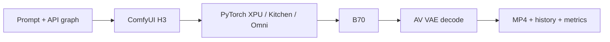

# MiniMax-H3 / Intel B70 最小部署测试项目

[English](README.md) | [简体中文](README.zh-CN.md)

独立的博客参考工程：在单张B70上通过Omni/ComfyUI运行量化H3 Base，完成文本→带音频MP4的提交、监控和验收。仅包含轻量客户端与配置，不包含llm-scaler源码、Docker镜像、权重、内部日志或个人信息。

## 范围与环境要求

本次基线是 `intel/llm-scaler-omni:0.2.0-b1`，Python3.12.3、PyTorch2.11.0+xpu、ComfyUI0.31.0，Torch SDPA、DynamicVRAM及4GiB预留。推理是PyTorch XPU，不是OpenVINO。官方完整H3还包含Context-IR和Regenerate-2K，本文不调用云端，也未验证这些模块。

- B70/Battlemage单卡约32GB显存；建议64GB级别主机内存。
- Linux及与平台匹配的Xe/GuC、GPU用户态运行时；`/dev/dri`可用。
- Docker权限、Python3（客户端仅标准库）、FFmpeg/FFprobe；可选xpu-smi与OpenSSH。
- 权重约42.5GB，建议至少100GB可用磁盘；复制下载缓存或源码构建需要更多。
- 本轮成功数据为768×448、5.167/10.125秒；不是768p/15秒或2K已验证承诺。



## 1. 获取此项目与上游

将占位符替换为发布后的GitHub地址；也可以直接解压项目ZIP。克隆llm-scaler到旁边目录，不加入本项目，也不创建submodule。

```bash
git clone https://github.com/<owner>/<repo>.git minimax-h3-b70-minimal
cd minimax-h3-b70-minimal
git clone https://github.com/intel/llm-scaler.git ../llm-scaler
python3 --version
docker --version
ffprobe -version
```

上游的Omni目录说明见 `../llm-scaler/omni/README.md`。运行本文无需构建上游源码，优先使用已发布镜像；main可能比本文b1基线更新。

## 2. 准备镜像与GPU

```bash
docker pull intel/llm-scaler-omni:0.2.0-b1
docker image inspect intel/llm-scaler-omni:0.2.0-b1 --format '{{json .RepoDigests}}'
lspci -nnk | grep -A3 -Ei 'VGA|Display'
ls -l /dev/dri
bash check_xpu.sh
docker run --rm --device=/dev/dri intel/llm-scaler-omni:0.2.0-b1 \
  python /llm/tools/validate_comfyui_image.py
```

小计算预期：`available=True`、`count=1`、`matmul=64.0`。不通过先处理驱动/设备访问问题，不加载H3；存在render节点不保证计算正常。

可选源码构建（不属于本文已验证镜像路径）：

```bash
cd ../llm-scaler/omni
XPU_TARGET=bmg bash build.sh
cd ../../minimax-h3-b70-minimal
# Set H3_IMAGE to the actual tag printed by the build, then repeat checks.
```

若b1标签不可获取，先核对上游release；不要直接假设新镜像兼容。设置 `export H3_IMAGE=实际镜像标签` 可切换镜像，随后重新验收。

## 3. 准备4份权重

```bash
export H3_DATA_DIR="$HOME/h3-data"
mkdir -p "$H3_DATA_DIR"/{models/{diffusion_models,text_encoders,vae,loras/h3},input,output,user}
cp extra_model_paths.yaml "$H3_DATA_DIR/extra_model_paths.yaml"
df -h "$H3_DATA_DIR"
```

从[Comfy-Org/MiniMax-H3](https://huggingface.co/Comfy-Org/MiniMax-H3)获取下列确切文件，或复用已有下载。遵循发布者许可证；原始BF16权重不能不改配置就替换。

| File | Directory under `models/` | Approx. size |
|---|---|---|
| minimax_h3_fl2va_pruned_int8_convrot.safetensors | diffusion_models | 20.97 GB |
| qwen3vl_32b_minimax_h3_nvfp4_awq.safetensors | text_encoders | 15.69 GB |
| minimax_h3_video_vae_fp16.safetensors | vae | 5.21 GB |
| minimax_h3_audio_vae_fp32.safetensors | vae | 0.61 GB |

可选命令下载：

```bash
python3 -m venv .download-env
.download-env/bin/python -m pip install huggingface_hub
.download-env/bin/hf download Comfy-Org/MiniMax-H3 \
  --include '*minimax_h3_fl2va_pruned_int8_convrot.safetensors' \
            '*qwen3vl_32b_minimax_h3_nvfp4_awq.safetensors' \
            '*minimax_h3_video_vae_fp16.safetensors' \
            '*minimax_h3_audio_vae_fp32.safetensors' \
  --local-dir downloads
```

下载可能保留上游子目录。下面逐个定位并归位；复制会临时多占42.5GB，空间有限可在确认路径后改为移动。旧文件缺失时停止核对版本，不静默换精度。

```bash
python3 - <<'PY'
import os, shutil
from pathlib import Path
base = Path(os.environ['H3_DATA_DIR']) / 'models'
files = {
 'minimax_h3_fl2va_pruned_int8_convrot.safetensors':'diffusion_models',
 'qwen3vl_32b_minimax_h3_nvfp4_awq.safetensors':'text_encoders',
 'minimax_h3_video_vae_fp16.safetensors':'vae',
 'minimax_h3_audio_vae_fp32.safetensors':'vae',
}
for name, folder in files.items():
    found = list(Path('downloads').rglob(name))
    assert len(found) == 1, (name, len(found))
    shutil.copy2(found[0], base / folder / name)
    print('Installed', folder, name)
PY
find "$H3_DATA_DIR/models" -name '*.safetensors' -exec sha256sum {} \; > model_sha256.txt
```

## 4. 启动服务

```bash
export H3_DATA_DIR="$HOME/h3-data"
bash start_h3_b70.sh
docker logs --tail 80 minimax-h3-b70-torch
python3 wait_ready.py --timeout 180
```

启动脚本自动创建目录并检查权重，默认端口仅绑定主机127.0.0.1:8188。就绪工具确认XPU和空队列；容器ID不代表服务已就绪。日志预期出现 `Starting server`。

已有同名容器会复用，其旧挂载/变量不会更新。修改配置需确认队列空闲后 `docker stop minimax-h3-b70-torch`、`docker rm minimax-h3-b70-torch`，再启动；数据卷保留。

## 5. 从小尺寸到港口场景

```bash
python3 verify_minimax.py --url http://127.0.0.1:8188 \
  --width 256 --height 160 --frames 124 --steps 20 --seed 42 \
  --submit --wait --timeout 1200 --output workflows/smoke_api.json

python3 verify_minimax.py --url http://127.0.0.1:8188 \
  --width 768 --height 448 --frames 124 --steps 20 --seed 70 \
  --prompt-file prompts/harbor_5s.txt \
  --submit --wait --timeout 1800 --output workflows/harbor_api.json
```

每条完成后再运行下一条。去掉 `--submit --wait` 只导出工作流，不占用GPU。API JSON不是带节点坐标的网页工作流。

预期客户端输出（示意）：

```text
Requested 768x448, 124 frames at 24 fps (5.167 seconds), 20 sampling steps, seed 70.
{"prompt_id": "...", "node_errors": {}}
Saved ..._NoLoRA_..._time155.47s_VRAMpeakNA.mp4 (... bytes)
Generation succeeded; saved .../history_<prompt_id>.json
```

155.47秒为历史基线，实际耗时会变化。未采集显存时NA正常，不代表零显存。输出位于 `artifacts/videos/`、`artifacts/history/`、`artifacts/reports/`，服务端同时保留在 `$H3_DATA_DIR/output/video/`。

## 6. 监控和显存记录（可选）

提交前另开终端运行进度监听器；只运行一个相同clientId的监听器：

```bash
python3 watch_comfy_progress.py --timeout 1800 \
  --output artifacts/diagnostics/progress.jsonl
```

显存采集也应在提交前启动。查询实际设备ID，不假设PCI地址。采集终端：

```bash
xpu-smi discovery
python3 collect_metrics.py --device 0 --timeout 1800 \
  --output artifacts/diagnostics/harbor_vram.jsonl
```

生成终端（与采集器在同一主机、同一工程目录）：

```bash
python3 verify_minimax.py --width 768 --height 448 --frames 124 --steps 20 \
  --seed 70 --prompt-file prompts/harbor_5s.txt \
  --metrics-file artifacts/diagnostics/harbor_vram.jsonl \
  --submit --wait --timeout 1800
```

下载名添加耗时、整卡采样显存峰值和LoRA标签。显存包括驱动/其他进程，不是CPU内存或Torch分配量，采样可能漏峰；xpu-smi JSON模式变化可能产生NA。Docker RAM不能代替显存。

## 7. 验收帧数、时长和音轨

```bash
VIDEO='artifacts/videos/<actual-output>.mp4'
ffprobe -v error -count_frames \
  -show_entries stream=codec_type,codec_name,width,height,r_frame_rate,duration,nb_read_frames,sample_rate,channels \
  -of json "$VIDEO"
ffmpeg -v error -i "$VIDEO" -f null -
```

港口配置预期124视频帧、24fps、5.166667秒，以及32kHz双声道音轨。ffmpeg应无解码错误并成功退出。仍需播放器检查运动和音画同步；音轨存在不代表主观质量合格。

## 8. 远程客户端（可选）

```bash
ssh -N -o ExitOnForwardFailure=yes \
  -L 18188:127.0.0.1:8188 <ssh_user>@<b70_host>
# In another terminal, inside your local copy:
python verify_minimax.py --url http://127.0.0.1:18188 \
  --width 768 --height 448 --frames 124 --steps 20 --seed 70 \
  --prompt-file prompts/harbor_5s.txt --submit --wait
```

保持SSH隧道开启。浏览器访问 http://127.0.0.1:18188 。Windows客户端无需GPU/PyTorch，PowerShell中用curl.exe。显存采集仍在B70主机；本地使用metrics-file前需同步文件，最简完整性能测试是在B70提交后下载归档。

## 9. 参数、注意事项与停止

- 宽高要求32的正倍数；帧数要求17k+5；24fps固定。124/243/362帧分别约5.167/10.125/15.083秒。
- steps是去噪步骤，不是秒数；prompt中的“15秒”不改变帧数。
- `--tiled-vae`只减少解码峰值，不解决采样阶段问题。
- `--lora h3/<adapter>.safetensors`可选；权重放models/loras/h3。必须核对主模型构建、sampler/shift和LoRA版本。Turbo通常需专用步数，不能任意降低普通基线步数。
- `--output`是工作流JSON路径；`--artifacts-dir`是结果根目录；客户端相对路径以脚本目录为基准。
- GPU高利用率与静止日志不能证明卡死，查看WebSocket采样步数。
- 超时不自动取消任务。查queue/history再决定，避免重复提交。

```bash
curl --noproxy '*' -fsS http://127.0.0.1:8188/queue
python3 verify_minimax.py --history '<actual-prompt-id>'
# Interrupt only when the running job is yours and can be stopped:
curl --noproxy '*' -fsS -X POST http://127.0.0.1:8188/interrupt
# Stop the service after work is complete:
docker stop minimax-h3-b70-torch
```

DEVICE_LOST/Xe wedged/GuC错误时先存日志、停止重试。容器重启不等于GPU复位；共享主机重启需协调。未提供未经验证的PCI reset/unbind。公开日志/history前再次脱敏。

## 结果边界与参考

本轮基线155.47秒/28.68GiB，Turbo8步84.07秒/28.69GiB（单次对照1.85倍）。另完成10.125秒生成。1344×768持续推进但约118秒/步后主动取消；本地2K观察300秒仅到1/20步，无完整输出。未做模型重训练、完整BF16质量基准或长期稳定性认证。公开版脚本通过离线配置/语法检查，未另占用GPU重新执行全套任务。

- [MiniMax H3](https://github.com/MiniMax-AI/MiniMax-H3)
- [ComfyUI H3 tutorial](https://docs.comfy.org/tutorials/video/minimax/minimax-h3)
- [Intel LLM Scaler Omni](https://github.com/intel/llm-scaler/tree/main/omni)
- [Recorded b1 documentation](https://github.com/intel/llm-scaler/blob/c07d93a2a6106e0ef8d37a7b5247fa2c1f281b47/omni/README.md)

上传GitHub时只上传此目录。`.gitignore`排除模型、视频、运行数据及上游克隆；本工程未附带模型或上游软件许可证授权，使用这些内容需遵循各自许可。
